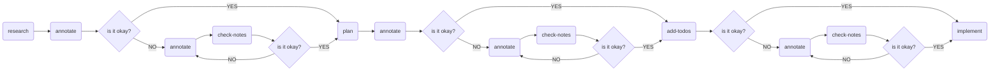

# Nobody

Nobody is a structured development workflow that keeps humans in the loop. Its skills and instructions ensure you own the architecture decisions, producing better results with significantly fewer tokens than ad-hoc AI coding. This workflow is based on the [Boris Tane pattern](https://boristane.com/blog/how-i-use-claude-code/#phase-3-implementation), read more about it if you want to understand the approach in depth.

Nobody provides a workflow for AI-assisted development:

Each stage is a skill that handles a responsibility.

## Skills

| Skill         | Trigger                                                   | What it does                                                                                                                                              |
|---------------|-----------------------------------------------------------|-----------------------------------------------------------------------------------------------------------------------------------------------------------|
| **research**  | `/research`, "research", "investigate", "how does X work" | Deep-dives the codebase, maps dependencies, and call data flows. Produces a **viewable markdown report**, open it in the viewer to annotate.              |
| **plan**      | `/plan`, "plan this"                                      | Reads a research document and produces a **viewable implementation plan** with architectural breakdowns, ready for annotation before any code is written. |
| **annotate**  | `/annotate`, "annotate", "open the viewer"                | Launches the webapp via Docker on port 9303 and mounts a markdown file for annotation.                                                                    |
| **review**    | `/review`, "review my comments", "process the feedback"   | Reads CriticMarkup annotations from a document, addresses each one, and outputs a clean document with zero markup syntax.                                 |
| **add-todos** | `/add-todos`, "add todos", "break this into tasks"        | Converts a reviewed plan into a phased, TDD-ordered todo list. Each task specifies exactly what to do and where.                                          |
| **implement** | `/implement`, "implement it all"                          | Executes the plan's todo list end-to-end. Does not skip tasks or pause mid-flow.                                                                          |

