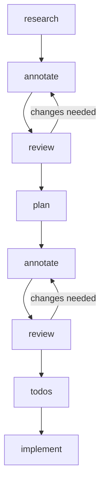

# Nobody

Nobody is a structured development workflow that keeps humans in the loop. Its skills and instructions ensure you own the architecture decisions, producing better results with significantly fewer tokens than ad-hoc AI coding.

Nobody provides a workflow for AI-assisted development:



Each stage is a skill that handles a responsibility.

## Project Structure

```
nobody/
├── skills/
│   ├── research/
│   ├── plan/
│   ├── annotate/
│   ├── review/
│   ├── add-todos/
│   └── implement/
├── webapp/              # React annotation viewer
│   ├── src/
│   │   ├── components/  # MarkdownViewer, AnnotationSidebar, etc.
│   │   ├── hooks/       # useAnnotations, useAnnotationLayout
│   │   └── lib/         # api, dom-highlight, remark/rehype plugins
│   ├── server/          # Node.js file read/write API
│   └── Dockerfile
└── lefthook.yml         # Git hooks (lint, typecheck, test)
```

## Skills

| Skill         | Trigger                                                   | What it does                                                                                                                                              |
|---------------|-----------------------------------------------------------|-----------------------------------------------------------------------------------------------------------------------------------------------------------|
| **research**  | `/research`, "research", "investigate", "how does X work" | Deep-dives the codebase, maps dependencies, and call data flows. Produces a **viewable markdown report**, open it in the viewer to annotate.              |
| **plan**      | `/plan`, "plan this"                                      | Reads a research document and produces a **viewable implementation plan** with architectural breakdowns, ready for annotation before any code is written. |
| **annotate**  | `/annotate`, "annotate", "open the viewer"                | Launches the webapp via Docker on port 9303 and mounts a markdown file for annotation.                                                                    |
| **review**    | `/review`, "review my comments", "process the feedback"   | Reads CriticMarkup annotations from a document, addresses each one, and outputs a clean document with zero markup syntax.                                 |
| **add-todos** | `/add-todos`, "add todos", "break this into tasks"        | Converts a reviewed plan into a phased, TDD-ordered todo list. Each task specifies exactly what to do and where.                                          |
| **implement** | `/implement`, "implement it all"                          | Executes the plan's todo list end-to-end. Does not skip tasks or pause mid-flow.                                                                          |

## Webapp

The annotation viewer is a React + TypeScript app served via Docker.

**Key capabilities:**

- Renders GitHub Flavored Markdown and Mermaid diagrams
- Select any text to create an inline annotation
- Annotations are shown in a sidebar with SVG connectors to the highlighted text
- Saves annotations back to the source file as CriticMarkup (`{==text==}{>>comment<<}`)

**Development:**

```bash
cd webapp
npm install
npm run dev
npm run dev:api
```

## Quality Gates

Git hooks run automatically via [Lefthook](https://github.com/evilmartians/lefthook):

- **pre-commit**: ESLint, Prettier, Stylelint
- **pre-push**: TypeScript type check, Vitest tests

CI (GitHub Actions) runs the same checks on every push and PR to `main`, and publishes a multi-arch Docker image (
`linux/amd64`, `linux/arm64`) on merge.

## License

MIT — Juan David Alzate Cardona, 2026
