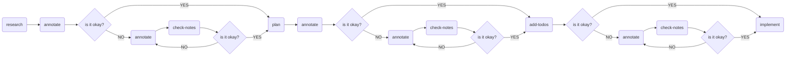

# Nobody

Nobody is a structured agentic workflow that keeps humans in the loop. Its skills and instructions ensure you own the
architecture decisions. This workflow is based on
the [Boris Tane pattern](https://boristane.com/blog/how-i-use-claude-code), read more about it if you want to understand
the approach in depth.

Nobody provides a workflow for AI-assisted development:

Each stage is a skill that handles a responsibility. As you can see, the key point is in the annotation cycle, this is
where the rigor comes in the human reviews and refines before moving forward.

## How it works

The moment you describe a feature or a problem, Nobody gets to work, but not by writing code.

First, it researches: mapping the codebase, tracing dependencies and call flows, and producing a written report you can actually read.

That report lands in an annotation viewer. You go through it, leave comments, correct anything off, and sign off when it reflects reality. Nobody then takes your notes and produces an implementation plan, concrete enough to follow.

You annotate the plan the same way. When you approve it, the plan becomes a phased task list with no ambiguity about what goes where. From that point, Nobody works through every task in order, no skipping, no improvising outside what you agreed on.

You reviewed it. You approved it. Nobody builds it.

## Skills

| Skill         | Trigger                                                   | What it does                                                                                                                                              |
|---------------|-----------------------------------------------------------|-----------------------------------------------------------------------------------------------------------------------------------------------------------|
| **research**  | `/research`, "research", "investigate", "how does X work" | Deep-dives the codebase, maps dependencies, and call data flows. Produces a **viewable markdown report**, open it in the viewer to annotate.              |
| **plan**      | `/plan`, "plan this"                                      | Reads a research document and produces a **viewable implementation plan** with architectural breakdowns, ready for annotation before any code is written. |
| **annotate**  | `/annotate`, "annotate", "open the viewer"                | Launches the webapp via Docker on port 9303 and mounts a markdown file for annotation.                                                                    |
| **review**    | `/review`, "review my comments", "process the feedback"   | Reads CriticMarkup annotations from a document, addresses each one, and outputs a clean document with zero markup syntax.                                 |
| **add-todos** | `/add-todos`, "add todos", "break this into tasks"        | Converts a reviewed plan into a phased, TDD-ordered todo list. Each task specifies exactly what to do and where.                                          |
| **implement** | `/implement`, "implement it all"                          | Executes the plan's todo list end-to-end. Does not skip tasks or pause mid-flow.                                                                          |

## Philosophy

*Never let Claude write code until you’ve reviewed and approved a written plan.*

AI is fast at generating code, but fast is not the same as right. The biggest risk in AI-assisted development is not a bug, it is building the wrong thing confidently. Nobody is designed around that risk.

The workflow forces a pause at every meaningful decision: after research, after planning, after breaking work into tasks. Each pause is an annotation cycle where you read, question, and push back before anything is built. The AI cannot skip these gates. You own the direction. You own the architecture. You own the design.

This also keeps the mental model in your head, not just in the output. When you annotate a plan you are not just approving it you are understanding it, and making sure the AI understands it too, before any implementation effort is spent. That understanding is what lets you catch mistakes, redirect scope, and reason about the system long after the session ends.

