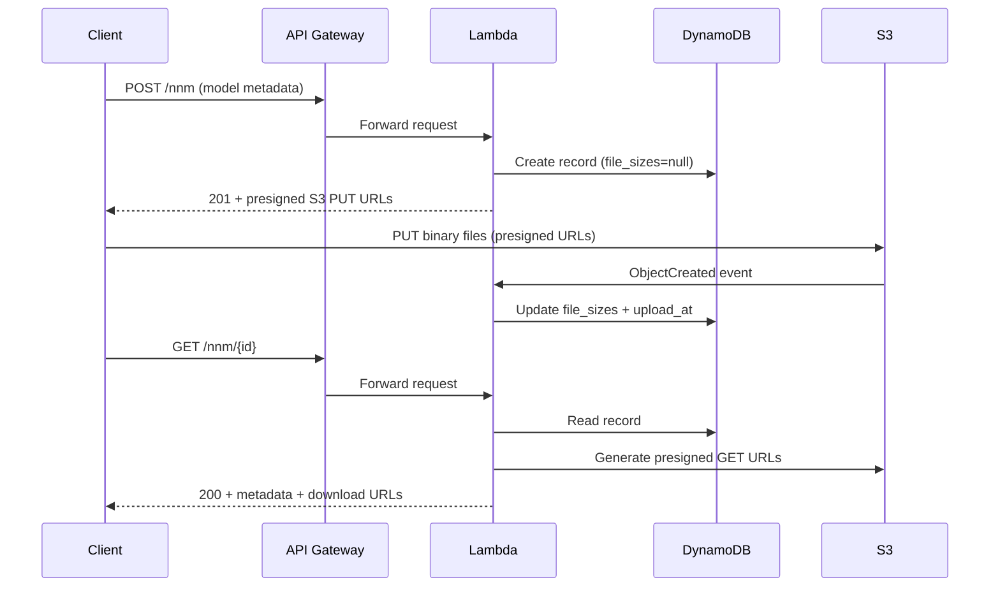

# Research Report

* **Prompt:** Understand the project neural-networks-manager — focus on models, tech stack, and purpose
* **Folders:** /Users/jdalzatec/Desktop/porter/neural-networks-manager
* **Generated:** 2026-04-02 00:00

---

## Executive Summary

`neural-networks-manager` (NNM) is a serverless REST API that acts as a **registry and file-distribution hub for trained neural network models** used in the Porter retail-analytics platform. It stores metadata for each model (name, type, detection task) in DynamoDB and stores the actual binary model files in S3. Authenticated callers interact with the API to create model records, upload files via presigned S3 URLs, retrieve metadata and download links, and delete models.

The system supports two neural network architectures — **MobileNet** and **ResNet18** — and a wide range of detection-task types covering person counting, gender classification, staff identification, and child detection. A dedicated Lambda function triggered by S3 upload events automatically tracks which files have been uploaded and their sizes, keeping the DynamoDB record in sync with S3 state.

The project is fully serverless on AWS (API Gateway → Lambda via Chalice, DynamoDB, S3) and is deployed with AWS CDK. It is Python 3.13, uses `uv` for dependency management, and `ruff` for linting.

---

## Tech Stack

| Category | Technology |
|----------|-----------|
| Language | Python 3.13 |
| API Framework | AWS Chalice 1.32+ (Lambda + API Gateway) |
| Infrastructure-as-Code | AWS CDK v2 (Python) |
| Database | Amazon DynamoDB (on-demand billing) |
| File Storage | Amazon S3 |
| AWS SDK | boto3 1.42+ |
| Schema Validation | cerberus 1.3+ |
| ID Generation | nanoid 2.0+ |
| Package Manager | uv |
| Linter | ruff |
| Pre-commit Hooks | pre-commit |
| CI/CD | GitHub Actions (deploy + lint workflows) |

---

## Directory Structure

```
neural-networks-manager/
├── runtime/                        # Chalice application (Lambda runtime)
│   ├── app.py                      # Entry point — creates Chalice app, registers blueprint
│   ├── .chalice/config.json        # Chalice deployment config
│   └── chalicelib/
│       ├── manager.py              # All REST route handlers (/nnm endpoints)
│       ├── db.py                   # DynamoDB CRUD layer
│       ├── schemas.py              # Cerberus validation schema
│       └── utils.py                # S3 helpers, validation, file naming
│
├── infrastructure/                 # CDK application
│   ├── app.py                      # CDK app entry point
│   ├── stacks/
│   │   └── chaliceapp.py           # Main CDK stack (DynamoDB + S3 + Lambdas)
│   └── resources/
│       └── handle_created_object/
│           └── main.py             # S3-triggered Lambda for tracking uploaded files
│
├── scripts/
│   ├── migration_scripts/          # One-off DynamoDB and S3 migration scripts
│   └── normalization_scripts/      # Historical schema normalization scripts
│
├── pyproject.toml                  # Project dependencies (uv)
└── .github/workflows/              # CI: deploy.yml, lint.yml
```

---

## Architecture Overview

```
Client (API key required)
        │
        ▼
API Gateway ──▶ Chalice Lambda (runtime/app.py)
                    │
                    ├── DynamoDB: NeuralNetworksManagerTable
                    │     (model metadata, file sizes, timestamps)
                    │
                    └── S3: portercount-nnm-{env}
                          (model binary files, per item_id prefix)
                                │
                                ▼ (S3 ObjectCreated event)
                        HandleObjectCreatedLambda
                          (updates file_sizes + upload_at in DynamoDB)
```

All API endpoints require an API key (`api_key_required=True`). CORS is enabled globally.

---

## Key Components

### REST API — `manager` Blueprint
- **Location:** `runtime/chalicelib/manager.py`
- **Purpose:** Handles all CRUD operations for neural network model records.
- **Endpoints:**

| Method | Path | Description |
|--------|------|-------------|
| POST | `/nnm` | Create a model record; returns presigned S3 PUT URLs for all files |
| GET | `/nnm` | List all models (optional query-param filters) |
| GET | `/nnm/{id}` | Get a single model with presigned GET URLs for uploaded files |
| PUT | `/nnm/{id}` | Update model metadata (deep-merges dicts) |
| DELETE | `/nnm/{id}` | Delete model record and all S3 files |
| GET | `/nnm/{id}/regenerate-urls` | Regenerate presigned upload URLs (2-hour expiry) |

### DynamoDB Layer
- **Location:** `runtime/chalicelib/db.py`
- **Purpose:** Thin CRUD wrapper over the DynamoDB table.
- **Key behaviors:** Uses conditional writes to prevent duplicate IDs; full table scans with `FilterExpression` for list queries; raises Chalice `BadRequestError`/`NotFoundError` on failures.

### Schema Validation
- **Location:** `runtime/chalicelib/schemas.py`
- **Purpose:** Cerberus schema enforcing model record structure.
- **Fields:** `id` (auto-generated nanoid), `name`, `description`, `network_type`, `detection_type`, `metadata` (free-form dict).

### S3 Utilities
- **Location:** `runtime/chalicelib/utils.py`
- **Purpose:** Presigned URL generation (PUT and GET), object deletion, file naming by network type, deep dict merge, schema validation wrapper.

### S3 Event Lambda
- **Location:** `infrastructure/resources/handle_created_object/main.py`
- **Purpose:** Triggered whenever a file is uploaded to S3. Parses the key (`{item_id}/{filename}`), updates the matching DynamoDB item's `file_sizes[filename]` and `upload_at` timestamp. This is how the system tracks which model files have been actually delivered.

### CDK Stack
- **Location:** `infrastructure/stacks/chaliceapp.py`
- **Purpose:** Provisions DynamoDB table, S3 bucket, the S3-event Lambda, and the Chalice app. Wires IAM permissions and event sources.
- **DynamoDB table:** Partition key = `id` (string). GSI on `name` field.
- **S3 bucket:** `portercount-nnm-{env}`, objects keyed as `{item_id}/{filename}`.

---

## Data Models

### Neural Network Record (DynamoDB item)

```json
{
  "id": "<nanoid>",
  "name": "string",
  "description": "string",
  "network_type": "mobilenet | resnet18",
  "detection_type": "<see below>",
  "metadata": {},
  "created_at": "ISO8601",
  "updated_at": "ISO8601",
  "upload_at": "ISO8601 | null",
  "file_sizes": {
    "labels.txt": "<bytes | null>",
    "images.zip": "<bytes | null>",
    "<network_file>.onnx": "<bytes | null>",
    "model.pth | model.pth.tar": "<bytes | null>"
  }
}
```

### Supported Network Types and Their Files

| `network_type` | ONNX file | PyTorch file |
|---------------|-----------|-------------|
| `mobilenet` | `mobilenet.onnx` | `model.pth` |
| `resnet18` | `resnet18.onnx` | `model.pth.tar` |

Every model record also carries `labels.txt` (class label list) and `images.zip` (training/validation images).

### Supported Detection Types

| Detection Type | Description |
|---------------|-------------|
| `normal` | Standard person detection/counting |
| `staff_tag` | Staff with visible tag detection |
| `gender` | Gender classification |
| `gender_staff` | Gender + staff combined |
| `gender_tag` | Gender + tag combined |
| `staff` | Staff detection |
| `gender_face` | Gender from face region |
| `gender_person` | Gender from full person |
| `staff_multiple` | Multiple staff categories |
| `staff_multiple_gender` | Multiple staff + gender |
| `gender_child` | Gender + child detection |
| `person_child` | Person + child detection |
| `gender_child_staff` | Gender + child + staff |
| `person_child_staff` | Person + child + staff |

---

## Data Flow

1. **Create model:** Client POSTs metadata → API validates with cerberus → DynamoDB record created with `null` file sizes → API returns presigned S3 PUT URLs (2-hour expiry).
2. **Upload files:** Client PUTs binary files directly to S3 using presigned URLs.
3. **File tracking:** S3 fires `ObjectCreated` event → `HandleObjectCreatedLambda` updates `file_sizes[filename]` and `upload_at` in DynamoDB.
4. **Retrieve model:** Client GETs model → API reads DynamoDB → generates presigned GET URLs only for files with non-null `file_sizes` → returns combined response.
5. **Update:** Client PUTs partial metadata → deep-merged into existing DynamoDB record (preserves nested dict fields not in the request).
6. **Delete:** API deletes all 4 S3 objects by key, then deletes DynamoDB record.



---

## External Integrations

- **Amazon DynamoDB** — model metadata store; table `NeuralNetworksManagerTable-{env}`
- **Amazon S3** — model file store; bucket `portercount-nnm-{env}`
- **AWS API Gateway** — HTTP entry point with API key auth
- **AWS Lambda** — Chalice app runtime + S3-event handler
- **AWS CDK** — infrastructure provisioning

---

## Patterns & Observations

- **Presigned URL pattern:** Files never flow through the API Lambda — clients upload/download directly to/from S3. This keeps Lambda payloads small and avoids binary data handling.
- **Event-driven file tracking:** The S3 → Lambda → DynamoDB pipeline decouples upload confirmation from the REST API, which is clean but means `upload_at` and `file_sizes` are eventually consistent.
- **Full table scans:** `get_all_items` always does a DynamoDB `scan`. For a model registry this is likely acceptable (small table), but will become expensive at scale.
- **No authentication layer in code:** Auth is handled entirely via API Gateway API keys (`api_key_required=True` on every route).
- **Environment via suffix:** All resources are suffixed with `NNM_ENVIRONMENT` (default `dev`), enabling multi-environment deployments from the same code.
- **Deep merge on update:** `merge_documents` recursively merges dicts, preserving nested keys not present in the update body — useful for the `metadata` field.
